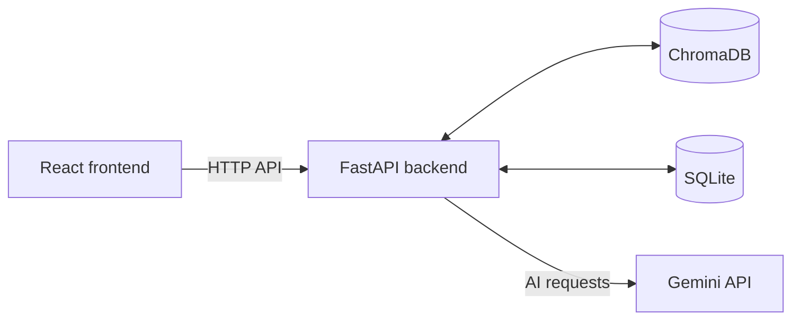

# AI Study Companion

AI Study Companion is a web app for the Multimodal AI Hackathon 2026, Track D.
It turns lecture videos, textbook PDFs and slide decks into a source-cited
knowledge base, with grounded chat, adaptive quizzes and a learner model.

## Features

- Ingests PDFs, PowerPoint slides (`.pptx`) and YouTube videos with captions.
  Each text chunk keeps its source page, slide number or video timestamp.
- Grounded chat answers from retrieved study material, cites the exact page,
  slide or timestamp, and says when the material does not cover a question.
- Creates MCQ, short-answer and numerical quizzes tagged with topic, source
  location and difficulty. A second AI call verifies generated questions.
  Verified questions are saved for reuse and are not repeated for the same
  student. Answers receive cited feedback and a weak-topics report.
- Tracks topic mastery using simple Bayesian Knowledge Tracing. New students
  start with a five-question MCQ diagnostic when enough questions are available;
  the backend can return fewer if its available question pool is short.
- Includes simulated-student evaluation and a RAGAS-style answer-quality check.

## Architecture

The React frontend sends requests to the FastAPI backend. The backend handles
ingestion, retrieval, quiz logic and learner data, using ChromaDB for vectors,
SQLite for application data, and the Gemini API for AI tasks. The frontend
never calls Gemini and never holds a Gemini key.



## Tech stack

- **Frontend:** React, Vite, Tailwind CSS, Radix UI components, Framer Motion,
  Recharts, react-confetti and react-pdf.
- **Backend:** Python and FastAPI.
- **AI:** Gemini API for embeddings and generation.
- **Storage:** ChromaDB for vector search and SQLite for learner and source data.
- **Content processing:** PyMuPDF for PDFs, python-pptx for slides, and
  youtube-transcript-api for YouTube captions.
- **Evaluation:** simulated students and a RAGAS-style judge.

## Project structure

```text
.
├── backend/
│   ├── config.py
│   ├── eval_students.py
│   ├── eval_ragas.py
│   ├── EVALUATION.md
│   ├── gemini_client.py
│   ├── ingest.py
│   ├── main.py
│   ├── prompts.py
│   ├── store.py
│   ├── chroma_db/          # Local vector store data
│   ├── data/               # Local SQLite data
│   └── uploads/            # Uploaded source files
├── Frontend/
│   ├── package.json
│   ├── FRONTEND_PLAN.md
│   └── src/
│       ├── api.js
│       ├── App.jsx
│       └── components/
├── .env.example
├── README.md
├── PROJECT.md
└── requirements.txt
```

## Setup and run

### Prerequisites

- Python 3.12 is used by the existing repository virtual environment (3.12.9).
  The project does not separately pin a Python version in `requirements.txt`.
- The repository does not pin a Node.js version. The frontend uses Vite 7;
  install a Node.js version supported by Vite 7.
- Git and npm.

### Clone and prepare the backend

Run these commands from the directory where you keep your projects:

```powershell
git clone https://github.com/payalshekhawat08-cpu/study-companion.git
cd study-companion
python -m venv .\venv
.\venv\Scripts\Activate.ps1
python -m pip install -r .\requirements.txt
Copy-Item .\.env.example .\.env
```

Open the `.env` file in the project root, next to `README.md`, and replace the
placeholder value for `GEMINI_API_KEY` with your own Gemini API key. Never
commit this file or share the key. Never put a Gemini key or other secret in a
variable beginning with `VITE_`; those values are visible to the browser.

Start the backend from the `backend` directory:

```powershell
cd .\backend
..\venv\Scripts\python.exe -m uvicorn main:app --reload
```

The API documentation is available at
<http://127.0.0.1:8000/docs>. The backend allows browser CORS requests only from
`http://localhost:5173` and `http://127.0.0.1:5173`.

### Start the frontend

In a second terminal, from the repository root:

```powershell
cd .\Frontend
npm install
npm run dev
```

Vite serves the frontend on port `5173` by default. Create or edit
`Frontend\.env.local` to configure:

```dotenv
VITE_USE_MOCK=false
VITE_API_URL=http://127.0.0.1:8000
```

`VITE_USE_MOCK` defaults to mock mode unless its value is exactly `false`.
Set it to `false` to use the backend. `VITE_API_URL` is the backend address and
defaults to `http://127.0.0.1:8000`. Neither variable should contain a secret.

## How to use it

1. Add a study source in the Library by uploading a PDF, slide deck or video, or
   by providing a YouTube link. Wait for processing to finish.
2. Ask a question in Chat. Check the source citations and open the cited page,
   slide or timestamp; if the source does not cover the question, the app says so.
3. Take the starter quiz, then choose quiz topics and answer the questions.
4. Open the mastery view to review progress and weak topics.

## API overview

These are the frontend/backend endpoints in the contract in `PROJECT.md`.
`GET /topics` is optional and is used for the course map.

| Method | Path | Purpose |
|---|---|---|
| POST | `/upload` | Add a file or YouTube URL for processing |
| GET | `/library` | List sources and their processing status |
| GET | `/files/{file_id}` | Retrieve an original uploaded file |
| POST | `/ask` | Ask a question against selected or all sources |
| POST | `/quiz` | Request a topic or diagnostic quiz |
| POST | `/quiz/answer` | Submit an answer and receive feedback |
| GET | `/mastery` | Get per-student topic mastery and weak topics |
| GET | `/topics` | List topics and prerequisites for the optional course map |

## Free-tier limits and design decisions

The Gemini free tier used for this project allows 20 text requests per day and
5 per minute. For a free-tier, limited-internet setup, the backend waits between
text calls (16 seconds between allowed calls), does not retry after a 429
quota response, saves verified generated quiz questions for reuse, and checks
quiz answers in code instead of making another Gemini call. The starter quiz
uses saved questions when available. These are project design decisions for
working within limited quota and connectivity.

## Evaluation

See [`backend/EVALUATION.md`](backend/EVALUATION.md) for the commands, options
and output files. From the repository root, run the simulated-student test with:

```powershell
.\venv\Scripts\python.exe .\backend\eval_students.py
```

The fixed-seed simulated run uses 15 questions per student. Reported average
mastery gains are 0.121 for weak, 0.238 for average and 0.378 for strong
students; repeated questions were 0 percent.

RAGAS-style judge, small test set: results pending

The official `ragas` package could not be imported in the current environment,
so the evaluation uses a RAGAS-style judge with the same four metrics:
faithfulness, answer relevancy, context precision and context recall. The
default command below is a dry run; a real evaluation requires explicit
`--real` opt-in and makes Gemini API calls.

```powershell
.\venv\Scripts\python.exe .\backend\eval_ragas.py
```

## Known limitations

- Only text is processed for search. Images, diagrams and figures are not
  searchable: image-description code exists, but is switched off and untested.
- YouTube videos need captions.
- Uploaded video files and the Gemini transcription fallback are implemented
  but untested.
- Short-answer grading is implemented but has not been tested in a live quiz.
- Topic prerequisites for the course map are not generated.
- Gemini's free tier can return busy (503) errors.

## Team

**Names and roles:** 
- Neha Khatri - frontend devloper
- Aaliya Rehmaan - 
- Kashish Vaishnav - 
- Payal Shekhawat - Backend devloper
